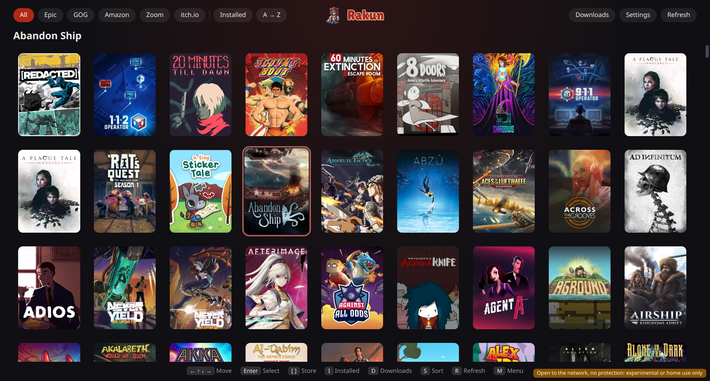
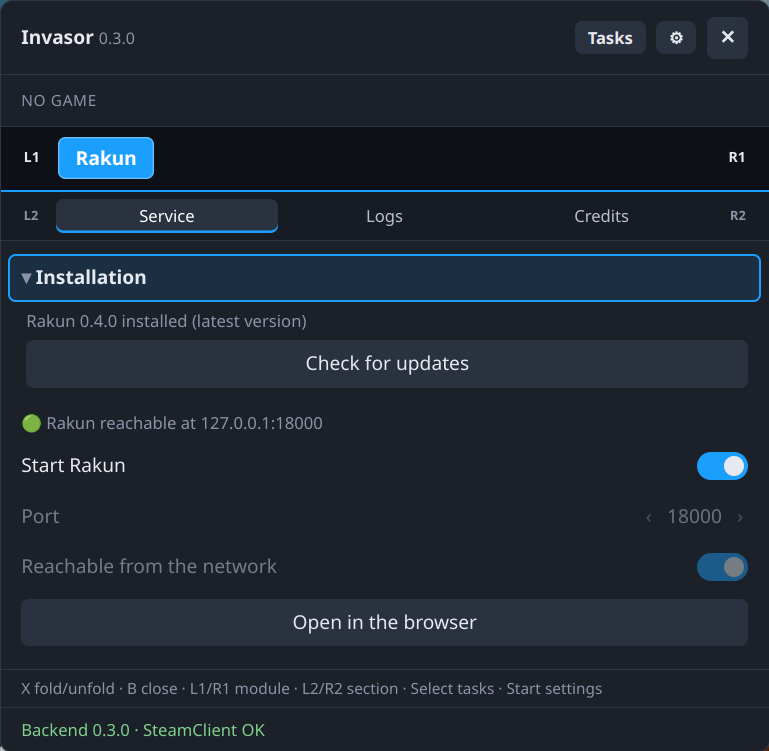
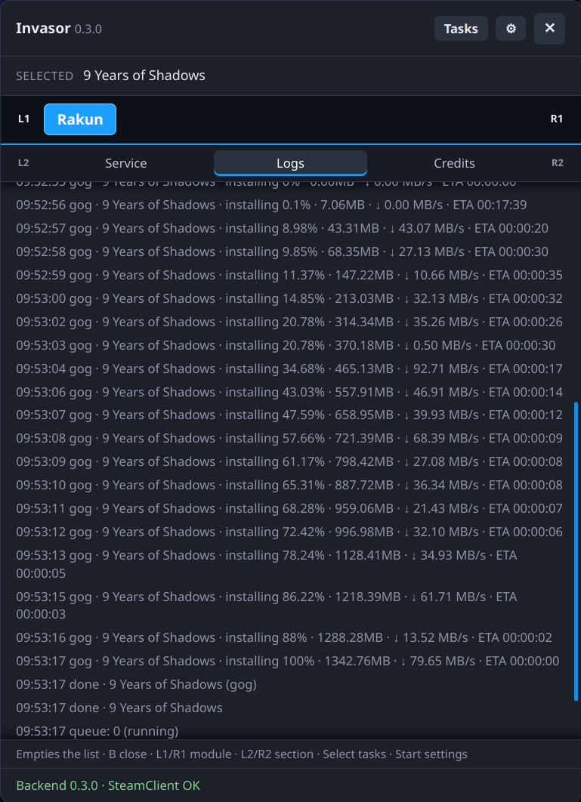

# invasor-rakun

An [Invasor](../invasor) module for **Rakun**, the headless service that logs in to Epic Games, GOG, Amazon Games and Zoom Platform, installs their games and adds them to Steam.

## What it does

Three tabs:

- **Service**, top to bottom:
  - an **Installation** section (it opens by itself when an update is available): whether Rakun is installed in `~/.local/opt/rakun/` and its version against the latest published release, asked to GitHub's API. A **Download** button installs it: the tarball of the latest release is downloaded with a progress bar, checked against the sha256 GitHub publishes for it (without one, Invasor asks you first), and installed with the `install.sh` that tarball carries. Once installed, **Check for updates** asks GitHub again (skipping the cache of the latest release) and, when the version differs, **Update** runs `rakunctl self-update`, which restarts Rakun if it runs. `self-update` only works on an install made by `install.sh`;
  - a green/red indicator: green when Rakun answers on `127.0.0.1:<port>` (checked every 3 s);
  - the **Start Rakun** slider, on while Rakun runs (asked with `rakunctl status --json`, so it does not need systemd). Switching it on runs `~/.local/opt/rakun/rakunctl start --port <port> --web <local|network>`; off runs `~/.local/opt/rakun/rakunctl stop`. If Rakun has pending tasks (a download or a library refresh) it refuses to stop and the module asks whether to **Stop anyway** (`stop --force`) or **Keep running**. The slider is disabled while Rakun is not installed;
  - the port (17999 by default, from 1024 to 65535), changed with − / +. While the slider is on it is read-only. It is saved in the module's own data (`~/.config/invasor/modules/rakun/data.json`);
  - **Reachable from the network**, a slider below the port (same rules: only while Rakun is stopped): off = `local` (default), on = `network`, passed to `rakunctl start` as `--web local|network`, saved with the port;
  - **Open in the browser**, which opens Rakun's web interface on that port in Steam's own browser, so it works in Game Mode. It is only enabled while Rakun runs.
- **Logs**: Rakun's events, formatted (`rakunctl events` is read in the background while Rakun runs): queue changes, game status and download progress, with the last 200 lines and a refresh every 3 s, plus a **Clear** button. When Rakun stops the list ends with `-- Rakun stopped --`.
- **Credits**: mentions Rakun and links to its repository, <https://github.com/FranjeGueje/rakun>.

The heavy operations are tasks in Invasor's panel, so the core itself announces when they start and end (with its toast sound) and the panel shows their progress bar: every game Rakun installs (percentage, size, speed and ETA, read from `rakunctl events` while Rakun runs, even if the Logs tab is closed), and installing or updating Rakun itself (the download with a bar, then the phase). A task still open when Rakun stops, when its download is paused, or after five minutes without news from Rakun, is marked as failed. A game's task is called `Rakun: <doing> <game>` (e.g. `Rakun: Installing A Tiny Sticker Tale`) and ends with what was done (`Installed`, `Updated`, `Repaired`, `Moved`) or how it failed (`Failed`, `Cancelled`, `Paused`). Uninstalling or importing a game is too quick for a task: it only shows a Steam notification, `Rakun: <game>` with `Uninstalled` or `Imported` as its text. Quick actions (start, stop, check for updates) only show a toast in the module, as before.

When an installation ends it also asks Steam to show the grid images Rakun downloaded for the game (capsule, hero, logo and wide capsule), the way the Artwork module does after applying one, so they appear without restarting Steam. The events carry no Steam app id, so it is read from Rakun's `~/.config/rakun/steam_shortcuts.json`, and the module waits (up to 3 minutes) for Rakun to register the game and write the images, in any Steam account's grid folder.

## Screenshots

<p align="center">
  
</p>

<p align="center">
  
  
</p>

## Requirements

- [Rakun](https://github.com/FranjeGueje/rakun) running on the console.
- Invasor 0.3.0 or newer (`min_core`): it uses `ctx.http` to ask GitHub and download Rakun, `ctx.archive` to unpack it, `ctx.paths` to find Steam's folders and `ctx.steam` to open the browser.
- Python 3.9+ (standard library only).

## How it works

```
rakun/
  module.json   metadata
  backend.py    open_web, install, check and update, the rakun switch (rakunctl), the saved port and web access, the tasks of the heavy operations and the grid refresh: the methods the UI calls
  grids.py      finds the images Rakun left in Steam's grid folders
  logs.py       reads `rakunctl events` in a thread and formats the lines
  texts.py      what the tasks and notifications say
  ui.ts         Service, Logs and Credits tabs
  tests/        unittest
```

CI runs the tests against the core's `main`; pushing a `vX.Y.Z` tag (it must match the `version` in `module.json`) publishes `rakun-<version>.zip` as a GitHub release, built against the core version in `core-ref` (`.github/workflows/release.yml`).

## Building

```bash
python3 ../invasor/tools/pack_module.py rakun     # typecheck, build, tests -> rakun-<version>.zip
python3 ../invasor/tools/install_module.py rakun-0.3.0.zip
```

or ⚙ Settings › Install module on the console.

## License

GPL-3.0-or-later.
